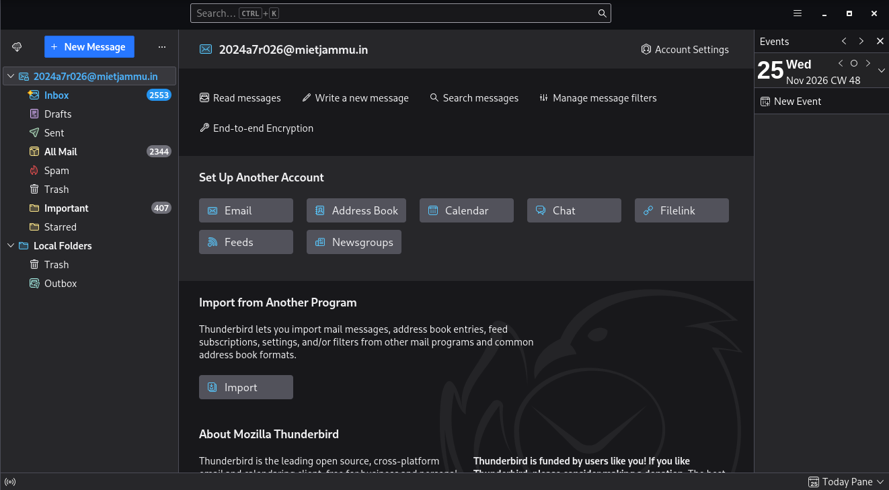
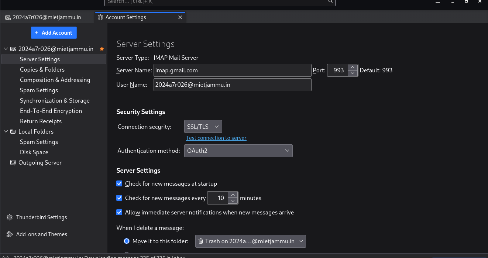
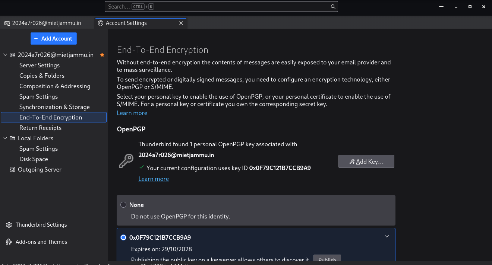
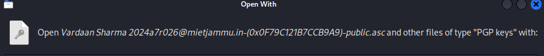

# Experiment 8: Public Key Generation, Exchange, Verification, and Secure Email

## Aim

To generate a public/private key pair, exchange public keys securely, verify the authenticity of the exchanged keys, and demonstrate encrypted and digitally signed email communication.

## Theory

Public-key cryptography uses an asymmetric key pair:

- A private key is kept secret by the owner.
- A public key is distributed to others.

The main idea is that:

- The sender encrypts data using the receiver's public key.
- Only the receiver can decrypt it using their private key.
- A sender signs a message using their private key.
- The receiver verifies the signature using the sender's public key.

This provides confidentiality and authentication. Thunderbird supports OpenPGP for encrypted and signed email.

## Tools Used

- Mozilla Thunderbird
- An email account configured in Thunderbird
- A second email account or recipient for the public-key exchange

## Methodology

### 1. Set up the email account

Install and open Mozilla Thunderbird, then add and sign in to the email account that will be used for the experiment. Complete any account verification required by the email provider.

### 2. Create an OpenPGP key pair

In Thunderbird, open **Account Settings** for the email account and select **End-to-End Encryption**. Use the OpenPGP key section to add or create a personal key for the account. Keep the private key protected and never export or share it.

### 3. Share the public key

Use Thunderbird's OpenPGP key options to export or attach the public key, then send it to the other participant. The public key can be shared; do not share the private key. The other participant should import this public key before sending encrypted email.

### 4. Import and verify the other participant's public key

Open or import the received public key in Thunderbird's OpenPGP key manager. Compare its fingerprint with the fingerprint provided by the key owner through a trusted, separate channel. This helps confirm that the key belongs to the intended recipient.

### 5. Compose and send an encrypted, signed email

Compose a message to the participant whose public key has been imported. In the message's security options, enable **Encrypt** and **Digitally Sign** (if available in the installed Thunderbird version). Review the recipient key and security status before sending.

### 6. Receive, decrypt, and verify the email

The recipient opens the message in Thunderbird. Their private key is used to decrypt it, and Thunderbird checks the sender's signature using the sender's imported public key. Confirm that the message can be read and that the signature is valid.

## Result

The experiment demonstrated setting up an email account in Thunderbird, creating an OpenPGP key pair, exchanging and verifying public keys, and sending and receiving an encrypted, digitally signed email.

## Observations

- Thunderbird created an OpenPGP key pair associated with the configured email account.
- The public key was shared with the recipient while the private key remained private.
- Verifying the key fingerprint helped confirm the recipient's public key.
- Encryption provided confidentiality, while the digital signature provided integrity and sender authentication.
- The recipient used their private key to decrypt the message and the sender's public key to verify its signature.

## Conclusion

This experiment demonstrated Thunderbird's OpenPGP email workflow. After logging in to an email account and creating a key pair, the public key was shared and verified before composing an encrypted and digitally signed message.

## Improvements

- Record the key fingerprint verification and the recipient-side successful decryption and signature verification.
- Include the Thunderbird version and email provider used so the procedure can be repeated; menu names may differ between versions.
- Repeat the exchange in both directions so each participant sends and receives an encrypted, signed message.
- Use test accounts and sample content, and redact email addresses, message contents, and key details in screenshots.

## Security Note

Keep private keys protected and never share them. Verify public-key fingerprints through a trusted channel before using a key to send encrypted email. Menu labels may vary slightly between Thunderbird versions.
